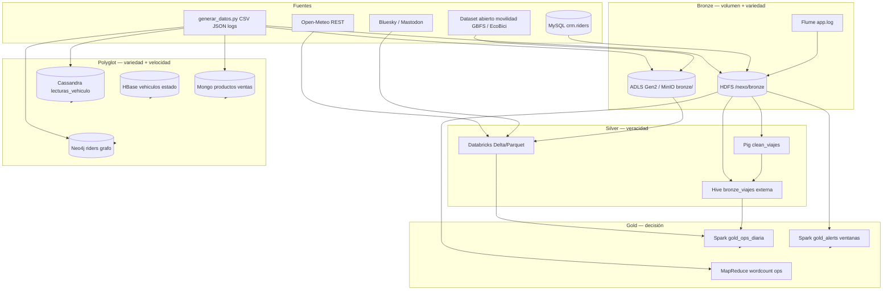

# Arquitectura medallion — NexoUrbano

Lakehouse operacional para operaciones en vivo, comercial y crecimiento (grafo social). Cada **V** queda anclada en al menos un motor del TP.

## Diagrama (vista lógica)

## Tabla V → motor

| V | Rol en NexoUrbano | Motor principal | Capa |
|---|---|---|---|
| **Volumen** | Millones de viajes y decenas de millones de lecturas/año | MinIO/ADLS `bronze`, HDFS, Spark batch | Bronze → Gold |
| **Variedad** | Tabular, documentos, series, grafo, texto, APIs | Mongo, Cassandra, Neo4j, Hive, MapReduce, Databricks | Bronze + serving |
| **Velocidad** | Batería baja, `payment_fail`, última posición | Spark Structured Streaming, Cassandra | Silver/Gold + serving |
| **Veracidad** | Contrato, rechazos, watermark, cuarentena sensores | YAML `bronze_viajes`, Pig/Spark filters, streaming watermark | Silver |

## Flujo por caso de negocio

| Frente | Entrada | Proceso | Salida |
|---|---|---|---|
| Operaciones | `lecturas_sensores`, `stream/`, `app.log` | Cassandra + Streaming + HBase | Retiro de vehículo, `gold_alerts` |
| Comercial | `productos.json`, `ventas.csv`, MySQL riders | Mongo CRUD + aggs, Sqoop/JDBC | Recomendación de pase, revenue Gold |
| Crecimiento | `grafo.json` | Neo4j Cypher | Amigos en común, fraude collusion, estaciones sugeridas |
| Contexto externo | Open-Meteo, posts sociales | Databricks M3 | Silver clima×viajes, señal de incidente |

## Convenciones de rutas

| Zona | Cloud (objetivo) | Local (repo / sandbox) |
|---|---|---|
| Bronze viajes | `abfss://bronze@<cuenta>.dfs.core.windows.net/viajes/yyyy/mm/dd/` | `s3a://bronze/viajes/` (MinIO) o `hdfs:///nexo/bronze/viajes` |
| Silver | Delta en contenedor `silver` | Parquet en HDFS o Volume Databricks |
| Gold | `gold/ops_diaria`, `gold/alerts` | `05-spark/batch`, `05-spark/streaming` outputs |

Frescura referencia: viajes **batch diario 06:00 ART** (`contratos/bronze_viajes.yaml`); alertas streaming **ventana 2 min**.
